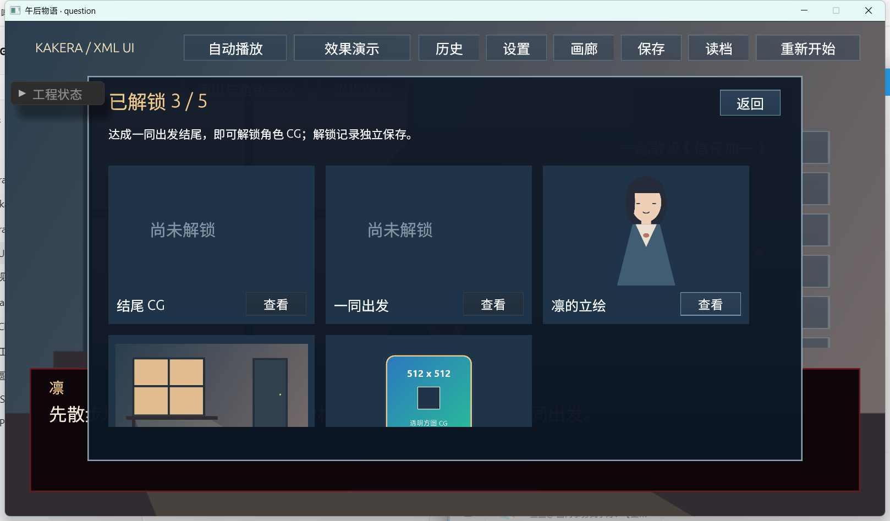
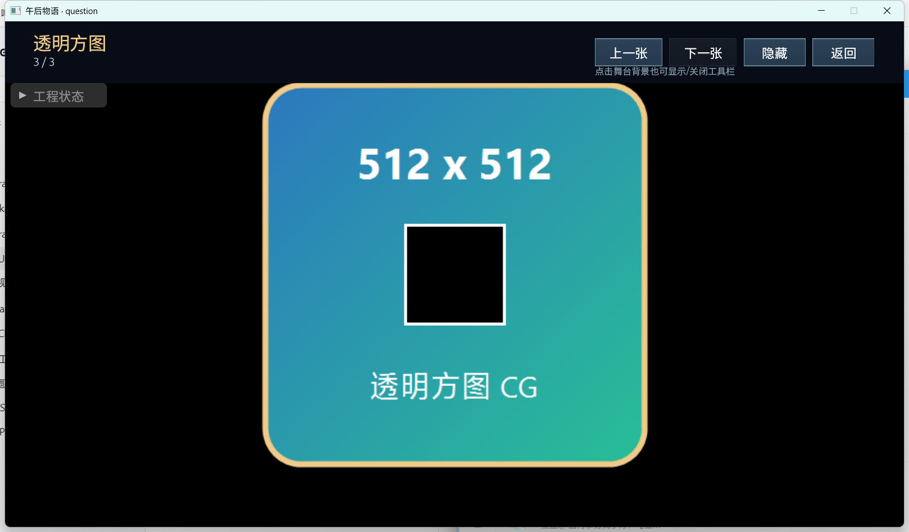
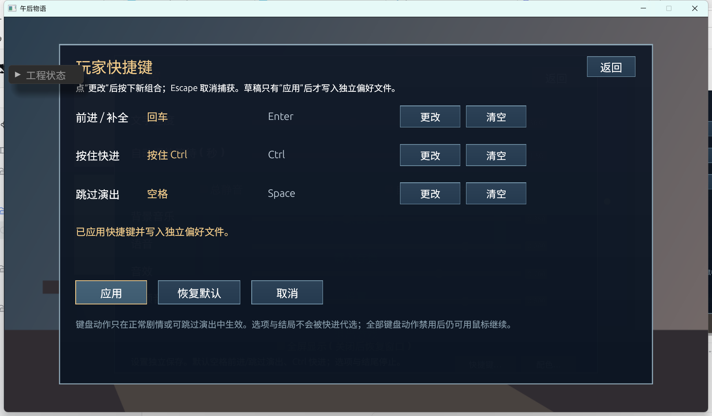
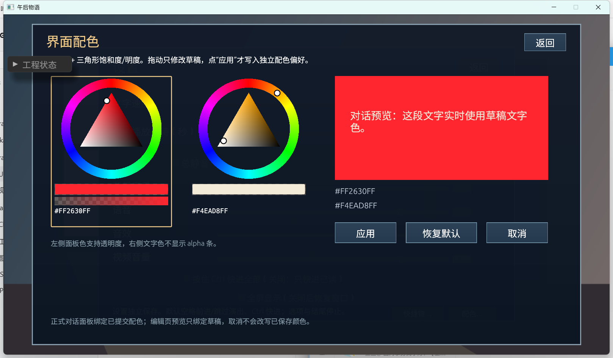
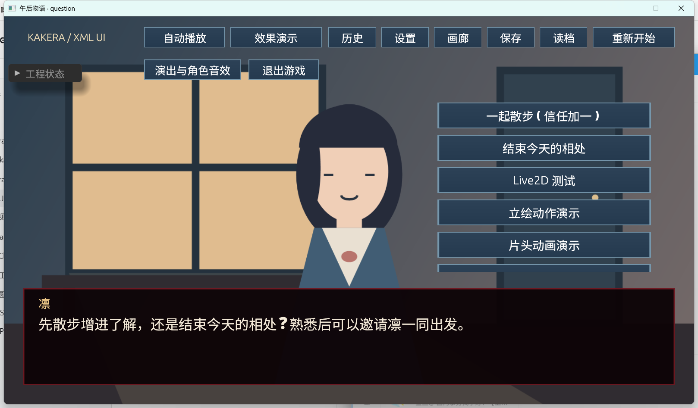

# UI 扩展性验收记录（v0.10.0）

日期：2026-10-29。范围：`doc/ui-extensibility-roadmap.zh-cn.md` 的工作包 A（动态图片与 CG 单页查看）、B（玩家快捷键）、C（三角 HSV 与玩家配色）。实现版本 **0.10.0**；数据契约仍为 story 8 / UI 3 / save 9 / profile 1 / read 1 / KPAK 1、2，demo content-version=11。

本文件记录实际执行结果，不把方案或旧版本测试总数算作本轮通过。未执行项在末尾单独列出。

版本定稿（2026-10-30）：本次功能及 HSV 输入/焦点修复统一命名为 v0.10.0。下文截图仍引用定稿前保存的 screenshots/v0.9.2 证据目录，保留原文件和实际验收日期；目录名不代表当前发布版本，也未因改版本号重新计数测试。

2026-10-30 独立复验后的修复补充：HSV 的首次获焦键盘穿透、隐藏后焦点残留及 Tab 无法从外部进入三个问题已修复。新增六项长期测试后，完整回归为 252 passed / 2 ignored；原生 D3D11 窗口复验了外部 Tab 进入、正反子区切换、方向键调色和 Escape 退出。详见 [独立复验的修复记录](ui-extensibility-independent-review.zh-cn.md#2026-10-30-修复与复验)。下文 246 项及截图保留为最初实现验收记录，未执行范围不据此改记通过。

## 1. 环境与检查命令

| 项目 | 实际值 |
| --- | --- |
| 系统 | Windows x64 |
| 渲染 | D3D11 硬件（feature level b000），实际窗口 |
| 逻辑舞台 | 1280×720，等比缩放；验收窗口截图 1618×947 |
| 存档目录 | `target/ui-accept-saves`（独立测试目录，不提交） |
| 验收方式 | 自动测试 + 工程、KPAK 1/2 `--check` + D3D11 实际窗口 |

```powershell
cargo fmt --check                         # 通过
cargo clippy --locked --all-targets -- -D warnings  # 通过
cargo test --locked                       # 246 passed, 2 ignored, 0 failed
cargo run --locked -- --check             # 通过：31 场景 / 19 UI 页面 / 2 视频 / 1 Live2D
git diff --check                          # 通过（仅提示行尾换行）
```

新增自动测试共 52 项：

| 位置 | 数量 | 覆盖 |
| --- | --- | --- |
| `src/shortcuts.rs` | 17 | 键表、规范/保留、冲突、整体交换、null、16KiB JSON |
| `src/color.rs` | 9 | HEX、六色相、三角权重/最近投影、sRGB 采样、灰黑保留、alpha、量化 |
| `src/app/input.rs` | 3 | 物理键映射、捕获释放屏障、纯修饰键 |
| `src/app/shortcuts.rs` | 8 | 捕获、持久化、坏文件、原子失败、改键、菜单/失焦、释放 |
| `src/app/colors.rs` | 2 | 配色应用/重开/清除/重置/坏文件/原子失败、混写拒绝 |
| `tests/ui_extensibility.rs` | 10 | 查看页、绑定、A/C 解析与事务、include、偏好文件排除、非模态根页 |
| `tests/color_picker_render.rs` | 3 | 环/三角/alpha/键盘/同帧点击/禁用 |

## 2. 工作包 A：同一查看页切换图片

### 自动证据

- **A01**：同一 `cg-view`、同一 `cgFull` 的 `image-bind` 从 `bg.room` 切到 `portrait.lin`，再切到 `cg.square`；标题、当前收藏 ID、计数、上一张/下一张可用状态同步；栈始终只增加一次查看页。
- **A02**：两个共享 `ui.shared` 的图片节点随一次 setUi 更新，独立的 `ui.own` 不受影响；共享变量不是复制纹理。
- **A03**：未声明资源、路径、URL、空串、错误变量类型均被拒绝；错误含 UI 文件/位置；JS 事件批失败保留旧状态。
- **A04**：改标题/图片并打开页面时任一绑定非法，整批不提交。
- **A05**：查看页是单个 `fit="contain"` image，1280×720 黑底；静态检查和 GUI 均确认。
- **A06**：连续 100 次绑定切换后，三张静态图片纹理 ID 不变；没有逐次解码/上传路径。
- **A07**：图集 `region-bind` 切换后越界被拒绝，旧 region 保留；只改变 UV 的既有测试仍通过。
- **A08**：未解锁条目在作者 JS 中被拒绝；禁用按钮无事件；查看前后 profile 不变。
- **A09**：模态查看页关闭只回到画廊；单 image 非模态根页通过显式 `Command::Open` 返回，`Close` 唯一根页仍拒绝。
- **A10/GUI**：隐藏工具栏后背景第一次点击只恢复工具栏，不关闭页面；第二次背景点击才关闭。
- **A11**：查看事件 `Operation::None`，不修改 Session、历史、已读、自动槽或 CG；GUI 返回后仍停在原选项场景。
- **A12**：`ui/cg-view.xml` 通过 include 合并；KPAK 1/2 各自独立 `--check` 通过。

### GUI 实际观察



- 画廊显示 5 个收藏（3 个已解锁）：结尾 CG、一同出发、凛的立绘、午后房间、透明方图；新增 512×512 透明方图是已声明专用 CG。
- 从“凛的立绘”打开查看页，标题、`2 / 3`、上一张/下一张和返回按钮正常；下一张切换到“透明方图”，`3 / 3`，下一张禁用；仍是同一页面、同一 `cgFull`。
- 透明方图的透明角与中央透明孔显示为黑色舞台，不是旧页面残留；图片 contain，中文正常。
- 点“隐藏”后工具栏消失、黑色覆盖完整舞台；点背景只恢复工具栏，再点“返回”回到画廊。



未在 GUI 单独打开 16:9 的“午后房间”查看页；它作为画廊缩略图和既有背景资源，自动测试覆盖三张不同资源切换。非模态单 image 根页只做自动验证，未另做 GUI 演示。

## 3. 工作包 B：玩家快捷键

### 自动证据

| 条目 | 结果 |
| --- | --- |
| B01 | 默认 advance/skip=Space、fast_forward=按住 Ctrl；动作表固定 |
| B02 | 完整 token 保存/读取往返；未知、重复、空白、裸分隔、超长、多段拒绝；修饰顺序规范化 |
| B03 | 物理键映射单测；中英文布局/IME 不把字符文本当键；左右 Ctrl 同为 ctrl 修饰 |
| B04 | Escape、Windows/Meta、Ctrl+Alt、Alt+F4/Alt+Tab 等系统组合拒绝 |
| B05 | 剧情动作同键、Ctrl 按住与 Ctrl+KeyK 前缀冲突；Space 同作 advance/skip 合法 |
| B06 | 同批交换成功；一个非法全部回滚；null 只禁用该动作 |
| B07 | schema/story_id/三动作完整性/16KiB/截断/非法组合/重复字段严格拒绝 |
| B08 | 缺文件默认；坏文件一次提示、保留原字节、不覆盖 |
| 捕获 | 启动点击/残留键释放→武装→组合→等待释放→一次结果事件；Escape/失焦/换页/读档/热更取消；捕获期间剧情键和媒体跳过被阻挡 |
| B20 | 改为 Enter 后原 Space 不再前进，Enter 每次只做一步；自动测试 |
| B21 | 改为 Tab 后原 Ctrl 不再快进，新键约 40ms 一步；选项/结尾停止 |
| B22 | 既有只读/全部快进与未读停住测试通过 |
| B23/B24 | 既有自动截图等待不要求松键、按住快进优先、松开重算 auto_delay 测试通过 |
| B25 | 失焦/提示/自动截图等待阻挡；恢复需释放；失焦键不重放 |
| B26 | UI sequence 改跳过键后旧键失效，新键只结束一次，不推进剧情 |
| B27 | 捕获期间不触发底层按钮/剧情；控件编辑门控按既有绘制与焦点规则 |
| B28 | 按住新/旧键时应用映射不立即执行，释放后重新按下才生效 |
| B29 | 多起始幕既有测试仍通过：初始菜单不隐式进入默认幕 |

### GUI 实际观察



- 设置 →“快捷键…”显示三个动作、已提交中文 Label（空格/按住 Ctrl）和规范草稿（Space/Ctrl/Space）。
- 点前进行“更改”，状态提示“请按下新按键”；按 Enter 后提示“已捕获 Enter”，草稿变为 Enter。
- 点“应用”后文件写入：

  ```json
  {"schema_version":1,"story_id":"kakera-demo","bindings":{"advance":"Enter","fast_forward":"Ctrl","skip_sequence":"Space"}}
  ```

  页面当前 Label 变为“回车”，提示“已应用快捷键并写入独立偏好文件”。
- 重启进程后按 Space 不推进；按 Enter 从 opening 推进到 question，证明跨进程恢复。进入剧情后对话点九图使用已应用配色（见 C 部分截图）。
- GUI 未单独执行 Escape 取消、保留组合冲突、清空后应用或“恢复默认”；这些由自动测试覆盖。

## 4. 工作包 C：三角 HSV 与配色

### 自动证据

| 条目 | 结果 |
| --- | --- |
| C01–C09 | 纯 color 模块 9 项：HEX 严格、六色相、三角顶点/重心/最近投影、`#804040FF` sRGB 采样、灰/黑保留、alpha、NaN/零尺寸、固定种子量化往返 |
| C20/C23 | 指针按下锁定环/三角/alpha；拖拽多移动同帧只产生一个事件；按下与释放同帧仍能编辑 |
| C21 | 禁用控件无事件；控件矩形作为阻挡区域；隐藏/失效页面不接收 |
| C22 | 实际 DPI 窗口点击按逻辑坐标命中（本次约 1.29 缩放）；未做 100/150/200% 矩阵 |
| C24 | 批次其他命令失败/坏颜色由 host 原子回滚；错误提示一次，抓取结束（自动/代码路径） |
| C25 | 页面栈变化、捕获开始、失焦、热更重置 picker 焦点/缓存/抓取；自动化覆盖页面栈与捕获清理 |
| C26 | 每个控件独立 cache/last hue/sat；未做专门双控件交叉截图 |
| C27 | Tab/Shift+Tab 子区循环、方向键步长/Shift 粗调、Escape 结束；自动渲染测试 |
| C28 | picker 焦点阻止普通剧情键；快捷键捕获优先并清 picker；未做同键 GUI 组合 |
| 偏好 | 应用/重开/清除/恢复默认；坏文件提示保留；目录占位导致原子写失败保留旧颜色；与 settings 混写拒绝；稀疏 overrides |
| 文件 | `schema_version=1`/`story_id`/16KiB/未知槽/重复键/非规范颜色严格拒绝；排除 KPAK/监控/显式 include |
| 装配 | palette/color-bind/color-picker 严格解析；include 合并；UI 全局最多 8 个 picker；尺寸/event/value/repeat/子节点限制 |

### GUI 实际观察



- 设置 →“配色…”显示两个真正的环 + 三角色盘：左侧面板色带 alpha 条，右侧文字色不显示 alpha 条；下方 HEX、预览面板和预览文字。
- 点左侧色环红色顶部：三角纯色顶点、环标记和 9 字符 HEX 更新，预览面板立即变为对应红色；草稿未应用时文件不变。
- 点三角内部：饱和度/明度与标记更新，HEX 变为 `#FF2630FF`；点“应用”后 `ui-colors.json` 写入 `dialogue_background="#FF2630FF"`。
- 返回主菜单进入剧情：HUD 对话点九图背景应用玩家覆盖色，台词使用 `colors.dialogue_text`（cream）；其他页面正常，剧情/history/CG 未改变。
- 未在 GUI 拖动 alpha 条、用 Tab/方向键调色、取消后重开验证草稿丢弃、在“恢复默认”后核对 HUD；这些留作未执行项或仅自动覆盖。



## 5. 打包与发布

| 项目 | 结果 |
| --- | --- |
| KPAK 2 | `49 文件`，资源包 22,695,463 字节；独立 `--check` 通过 |
| KPAK 1 | `49 文件`，资源包 21,555,671 字节；独立 `--check` 通过 |
| 偏好排除 | 工程根放入 `keybindings.json`、`ui-colors.json` 及大小写变体：`package::files` 不收集，`Selection::discover` 不依赖；`kakera.package.json` 显式 include 这两种文件被拒绝 |
| 源工程 | 打包不改写 `games/demo`；新 UI include 合并进原入口，包内仍 19 个页面 |
| 内容版本 | story 8/UI 3/save 9/profile 1/read 1/content-version 11 不变；未新增剧情槽字段 |

## 6. 未执行项与限制

- 未在 CPU 像素模式窗口复验；本记录只代表 D3D11 硬件窗口。色彩像素对比、AA 边缘误差和长时 60 秒连续拖动未做。
- 未执行 100%/150%/200% DPI 全矩阵、多显示器/跨屏、200% 实际缩放、远程桌面；只观察到一个约 125–129% 缩放窗口。
- 未测试中文/英文/IME/其他键盘布局下的物理键差异；当前 egui-winit Windows 桥无法区分部分小键盘键与主行键（Numpad0/9、NumpadEnter、NumpadSubtract/Divide 等），API 第 34 节已注明。`NumpadAdd` 可识别。
- 未对 B/C 做声音、音频设备或主观听感验收（本包不改变音频）。
- GUI 未单独覆盖：捕获 Escape、保留组合冲突、清空/恢复默认、UI sequence 改键跳过、同键 picker 与快进/前进、自动保存等待下持续按住快进；这些由自动测试或既有测试覆盖，未做本轮实际窗口复验。
- GUI 未覆盖：alpha 拖动、键盘 Tab/方向键调色、取消草稿丢弃、双 picker 独立缓存、热更删除已覆盖槽位、坏偏好/写失败的窗口级故障注入；自动测试覆盖了写失败与坏文件。
- 未做专用 CG 的跨进程读档、隐藏交接和自动档恢复；既有 CG/save 9 测试仍通过，但未将它们当作本包新增功能的 GUI 验收。
- 16:9 横图未在查看页 GUI 单独打开；三资源切换由自动测试覆盖，GUI 实际查看的是竖图与正方形透明图。
- 未测试发布目录从源码外运行 GUI；只在源码环境对两种包执行 `--check`。

结论：A 的核心复用查看能力、B 的捕获/应用/持久化/输入所有权、C 的纯数学/控件/绑定/偏好主路径已实现并通过自动检查和部分实际窗口验收；上列未执行项不能写成已通过。


